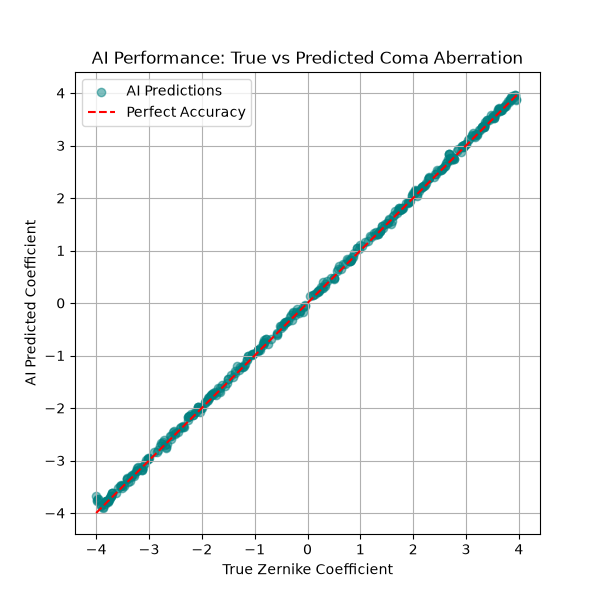
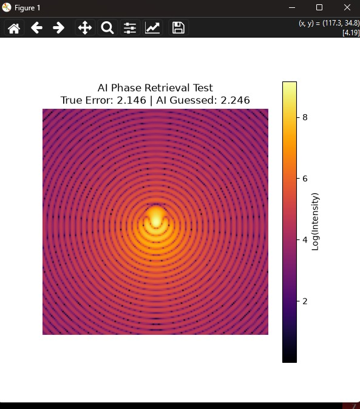

# AI-Driven Wavefront Phase Retrieval (Adaptive Optics)

## The Problem
In real-world optical systems—whether it's a ground-based telescope looking through the atmosphere or a microscope looking through biological tissue—light waves get distorted. The major engineering bottleneck is that standard camera sensors can only measure light **intensity** (the blur), completely losing the **phase** information (how the wave was actually bent). 

I built this project to solve this inverse problem. Instead of using expensive, physical hardware sensors to figure out what went wrong, this pipeline uses a Convolutional Neural Network (CNN) to look at the blurred focal-plane intensity and mathematically reverse-engineer the exact physical phase distortion that caused it. 

## The Physics & Simulation
Because real-world, perfectly isolated aberration datasets are hard to come by, I wrote a physics engine in Python (`scipy` and `numpy`) to simulate the wave propagation. 

* **The Wavefront:** I defined a circular Generalized Pupil Function and applied Coma aberrations using standard Zernike polynomials ($Z_7$). 
* **Wave Propagation:** To simulate what the camera actually sees, I computationally propagated the light wave to the focal plane using the Fraunhofer diffraction integral via a 2D Fast Fourier Transform (`scipy.fft.fft2`). 
* **Handling Artifacts:** To avoid circular convolution artifacts and increase the sampling density of the focal plane, the 256x256 wavefront is heavily zero-padded to 1024x1024 before the FFT. The resulting intensity matrices (Point Spread Functions) are log-scaled to compress the massive dynamic range, making the faint higher-order diffraction rings visible to the neural network.

## The Machine Learning
The model is a custom PyTorch CNN designed to act as the "brain" of a sensorless adaptive optics system. 

Instead of classifying an image, it performs regression. It takes the 160x160 diffraction pattern as a single-channel input, extracts the asymmetrical edge features of the Coma aberration through two Convolutional and Max Pooling layers, and passes them through Fully Connected layers to output a single, continuous scalar: the exact physical Zernike RMS amplitude.

*Note: I specifically designed the data pipeline and CNN architecture to be lightweight so the entire end-to-end training process can execute efficiently on a standard local CPU (like an i3 processor with 8GB RAM) without requiring heavy cloud GPUs.*

## Results

The network successfully learns the underlying wave physics rather than just memorizing images. Below are the predictions vs. the true mathematical coefficients on unseen test data.

**Parity Plot:**



**Inference Demo:**


---

## How to Run It Locally

### 1. Setup the Environment
You can recreate the exact lightweight environment used for this project:
```bash
pip install -r requirements.txt

### 2. Generate the Dataset
Since the 650MB .npz archive is too large to host on GitHub, you can generate your own synthetic dataset of 2,000 optical simulations using the physics engine:

Simply type python generate_dataset.py in your anaconda prompt or run the file in ur IDE.

### 3. Train the Network
Feed the dataset into the PyTorch CNN. It will output the training/testing loss per epoch and save the final network weights to coma_cnn.pth. It will also generate a parity plot to validate the physics.

Run the file train_cnn.py

### 4. Test Live Inference
To see the AI in action, run the diagnostic script (demo_inference.py). This generates a brand new, random optical aberration, simulates the resulting diffraction pattern, and asks the trained AI to deduce the error from the image alone.

